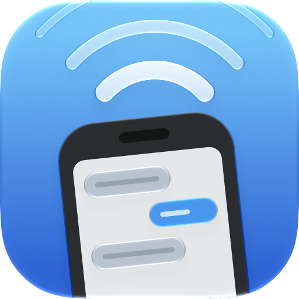

# KDE connect swiftui (in lack of a better name)



A simple SwiftUI app that provides a native UI for the `kdeconnectd` daemon.

I built this because other alternatives (like [KonnectMac](https://github.com/aryarajsingh/KonnectMac)), while impressive as a rewrite, are not feature complete, and I DO NOT have the tokens to finish that. So I opted for this approach instead.

It may be buggy — I vibe coded this in a few hours — and I may not maintain this.

CLANKER TEXT STARTS HERE
↓↓↓↓↓↓↓

---

A native SwiftUI app for KDE Connect on macOS. It replaces the Qt window
(`kdeconnect-app`) and the Qt menu bar indicator, but keeps the official
`kdeconnectd` daemon. Release builds include the official pre-built KDE
Connect app. Source builds can also use `/Applications/KDE Connect.app`.
The protocol, pairing, and plugins stay upstream code. This app is only the UI and a supervisor.

## Why

The stock macOS indicator can lose its link to the daemon. The cause is the
macOS bootstrap. KDE Connect does not use a system session bus on macOS:

1. The launcher starts a private `dbus-daemon --address unix:tmpdir=/tmp`.
2. It writes the bus address to `/tmp/private_dbus_address`.
3. It starts `kdeconnectd` with that bus in its environment.

When the daemon or the bus restarts, the address changes. Clients that stay
on the old bus look "de-attached", and old `dbus-daemon` processes stay
behind. This app reads the address file again on every check, reconnects,
and restarts the daemon when it is missing or on a dead bus.

## Features

- **Main window** (replaces `kdeconnect-app`): devices in a sidebar
  (connected, remembered, available, pairing requests), with "Pair New
  Device…" as the last row and swipe actions (Ring, Unpair). The device
  page has a header with status, battery, a refresh button and the actions
  (glass buttons: Ring, Ping, Send clipboard, Send files, Messages), then
  tabs: Overview (notification cards: swipe a card off to either side with
  two fingers to dismiss it; reply on hover or from the context menu),
  Plugins (switches and settings) and Details. Point at an action to see
  its name. Drop files on the window to send them: the page fades to a drop
  area, and a ring next to the actions shows the upload progress.
- **Messages** (replaces `kdeconnect-sms`): the Messages action opens a
  pop-up above it, in the style of Messages on iPhone. It shows the SMS
  conversations, opens one with a slide, and sends with Return
  (Option-Return starts a new line). The compose button starts a
  conversation with a contact or a number. Names and photos come from the
  contacts that the phone syncs, then from the Mac's Contacts, if you allow
  access. A click on a picture opens it. The device submenu in the menu bar
  also has "Messages…".
- **Plugin settings**: the gear next to a plugin opens its settings, the
  same set as the stock app: clipboard (auto share, passwords, file size),
  share (download folder), run commands (commands that devices can run on
  this Mac) and presentation pointer.
- **Pairing**: "Pair Device…" (⌘N, toolbar, menu bar) lists devices nearby,
  adds a device by IP address, and shows this Mac's addresses. A pairing
  request from a device shows an Accept/Reject alert.
- **Settings window**: this Mac's device name, open at login, connection
  types (LAN, Bluetooth), device addresses for networks without discovery
  (for example Tailscale), and service supervision.
- **Menu bar**: a plain native menu with one submenu per device.
- **Supervisor**: starts `kdeconnectd` when it is missing, and restarts it
  with a fresh bus when its bus is gone. Asks for a new network announcement
  after wake.
- A manual launch opens the window. A launch at login stays in the menu bar.

## Requirements

- macOS 27 or later.
- Apple Silicon for the downloadable release.
- Source-only builds need the official KDE Connect.app in `/Applications`.
  Bundled builds download it automatically; no KDE or Qt build is needed.

## Download

Get the ZIP from [GitHub Releases](https://github.com/RVZO6/kdeconnect-native/releases).
The latest release is **0.0.1-alpha.3**, marked as a pre-release. Extract the ZIP
and move **KDE Connect Native.app** to Applications before opening it. The
release includes KDE Connect; do not install a second copy for this app.

The alpha is ad-hoc signed, not Developer ID signed or notarized. If macOS
blocks it and you trust the download, use **System Settings → Privacy &
Security → Open Anyway** after the first launch attempt. Do not disable
Gatekeeper for the whole system.

## Build and install

```sh
Scripts/build-app.sh                       # uses an installed KDE Connect app
Scripts/build-app.sh --bundle-kdeconnect   # downloads and includes KDE Connect
Scripts/build-app.sh --bundle-kdeconnect --install  # copies to ~/Applications and opens it
swift test                                 # unit and regression tests
bash Tests/Scripts/build-app-tests.sh       # isolated install/launch retry tests
Scripts/package-release.sh                 # self-contained arm64 ZIP + SHA-256
Scripts/verify-release.sh                  # verify ZIP and relocated private bus
```

Then remove the stock "KDE Connect" from **System Settings → General → Login
Items**, and turn on "Open at login" in this app's settings. Do not run the
stock indicator or `kdeconnect-app` at the same time.

## CI and releases

GitHub Actions tests and packages the app on pushes to `master`, pull requests,
and manual runs. Download the ZIP from the run's **Artifacts** section. CI uses
an Apple Silicon `xcode-27` runner because both the app and its Icon Composer
assets require macOS 27. KDE Connect is **not compiled**.

`Scripts/kdeconnect-version.env` pins the official KDE download URL and SHA-256.
The disk image is cached by that file's hash, and its checksum is checked on
every build, including cache hits. The full upstream app is copied unchanged
into `Contents/Helpers`, with its signatures, libraries, plugins, and licenses.
The native app uses this helper before it checks for an installed KDE Connect.

The upstream pin belongs to each source commit and release tag, not to a global
CI setting. To upgrade KDE Connect for a later release, change the version, URL,
and checksum together, then test the resulting archive. Old tags keep their
old pin. KDE publishes these macOS binaries on [its download service](https://kdeconnect.kde.org/download.html),
not GitHub Releases. For a local build with another pre-built app, set
`KDECONNECT_APP_PATH="/path/to/KDE Connect.app"` and pass `--bundle-kdeconnect`.
Set `KDECONNECT_CACHE_DIR` to relocate the download cache if required.

To publish a release:

1. Update `VERSION`, the numeric `CFBundleShortVersionString`, and
   `CFBundleVersion` in `Resources/Info.plist`. The first alpha uses `0.0.1`,
   build `1a1`, and tag `v0.0.1-alpha.1`.
2. Update `.github/RELEASE_NOTES.md` and the upstream pin/notices if required.
3. Commit and push. Create and push a tag that equals `v` plus `VERSION`.
4. CI tests, packages, verifies, and uploads the ZIP, checksum, and matching
   KDE Connect source archive. Only after that job passes does it publish a GitHub **pre-release**.

The workflow currently marks all tag releases as pre-releases. Change that
policy before publishing a stable release. No signing secrets are needed for
these alpha builds. Developer ID signing and notarization are not configured.

## Code review

CodeRabbit reviews new non-draft pull requests and updates its review when new
commits are pushed. Repository-specific settings are in `.coderabbit.yaml`.
Reviews focus on correctness, Swift concurrency, D-Bus, daemon lifecycle, and
release packaging. Automatic approvals are disabled. Review context stays
local to this repository; cross-repository and external issue-tracker context
are disabled.

To request another review, comment `@coderabbitai review` on a pull request.
Use `@coderabbitai configuration` to inspect the resolved review settings.
CodeRabbit does not review direct pushes to `master`; open a pull request when
you want an automated review.

## Design

| Module | Contents |
| --- | --- |
| `DBusKit` | Small pure-Swift D-Bus client: wire format, SASL EXTERNAL auth, method calls, signals. No libdbus. |
| `KDEConnectKit` | Typed `kdeconnectd` API (`KDEConnectClient`), process control (`DaemonProcess`), and the observable app state with the supervisor loop (`KDEConnectStore`). |
| `KDEConnectNative` | The SwiftUI app: main window, settings and menu bar menu. |
| `dbus-probe` | Development tool: `dbus-probe introspect <path>`, `dbus-probe call <path> <iface> <member> [args]`, and `dbus-probe watch <seconds> …`, which makes the call and prints the signals that follow. Arguments can have a type prefix, such as `x:65` or `i:0`; `s:` passes the rest as a string. |

The app starts `kdeconnectd` and `dbus-daemon` with `posix_spawn` and stays
responsible for them. macOS then applies the privacy permissions (Bluetooth,
local network) of this app, so its Info.plist declares Bluetooth and local
network use. Do not disclaim responsibility: `kdeconnectd` is a bare
executable without a bound Info.plist, so TCC stops it when it must ask for
Bluetooth access.

## Debugging

- Supervisor log: `log stream --predicate 'subsystem == "app.kdeconnect-native"' --info`
- Daemon output: `~/Library/Logs/KDEConnectNative/kdeconnectd.log`
- Print the sidebar position while it toggles (one toggle, then a fast burst): `"build/KDE Connect Native.app/Contents/MacOS/KDEConnectNative" --sidebar-test`
- Save an image of the real window, title bar included: `"build/KDE Connect Native.app/Contents/MacOS/KDEConnectNative" --window-snapshot /tmp/window.png`
- Fill the window with a sample connected phone, without the daemon: add `--demo` (for example with `--window-snapshot`, which also saves a capture with the page scrolled)
- Post a synthetic two-finger swipe each way over the first notification and save captures: `--demo --swipe-test /tmp/swipe`
- Expand and collapse the notification stacks and save frames during the animation: `--demo --stack-test /tmp/stack`
- Drag the sidebar edge with posted mouse events, then open Settings and print the window levels: `--demo --resize-test`
- Switch the device tabs and print the main-thread layout and draw time of each switch: `--demo --tab-test`
- Open the Messages pop-up, open a conversation, send and receive a message, and save captures during each animation: `--demo --messages-test /tmp/messages` (set `KDCN_APPEARANCE=light` or `dark` to override the appearance)
- Print which view a click in the toolbar row reaches over the page centre: `--demo --hit-test`
- Render the main window to a PNG: `"build/KDE Connect Native.app/Contents/MacOS/KDEConnectNative" --snapshot /tmp/window.png`
- Run the scrolling workload without a daemon: add `--demo --demo-notifications 300 --demo-apps 20 --ui-benchmark /tmp/ui.json`
- See [performance measurements and test commands](Benchmarks/README.md).
